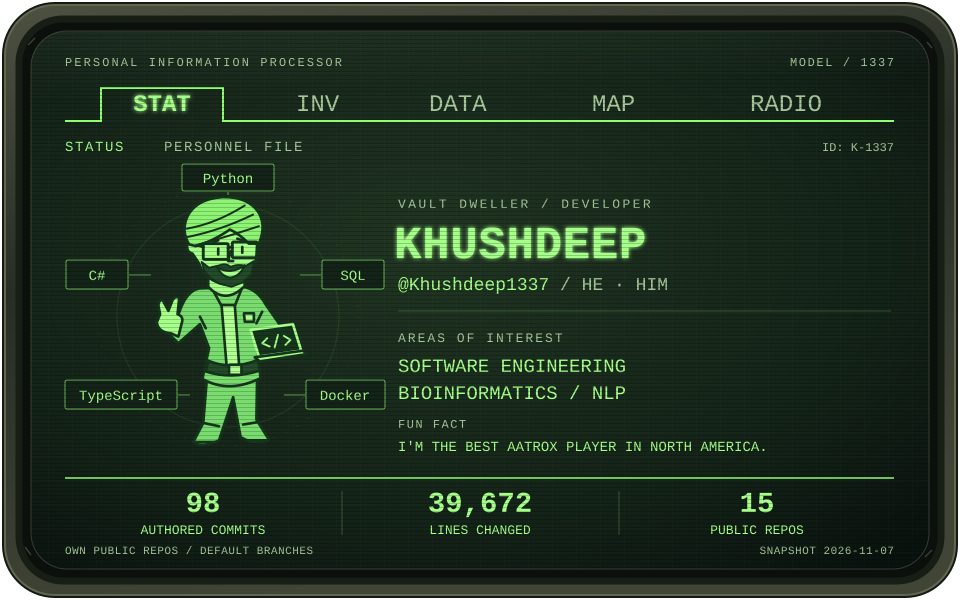

<picture>
  <source media="(max-width: 600px)" srcset="assets/pip-boy-mobile.svg">
  
</picture>

<!-- STATS:START
Generated by scripts/update-stats.mjs. Updated 2026-11-13 (Etc/GMT+7).
Source: /users/Khushdeep1337/repos and /repos/Khushdeep1337/{repo}/stats/contributors.
98 commits; 31,912 additions + 7,760 deletions = 39,672 lines changed.
Scope: owned public non-fork default branches, attributed to this GitHub login.
Per-repository totals; private, organization-owned, and fork activity is excluded.
STATS:END -->

  <a href="#about-me">STAT / ABOUT</a> &nbsp;·&nbsp;
  <a href="#highlighted-projects">DATA / PROJECTS</a> &nbsp;·&nbsp;
  <a href="#contact">RADIO / CONTACT</a>

## About me

I'm **Khushdeep**. My interests sit at the intersection of **software engineering, bioinformatics, and NLP**. Lately, I've been building tools around AI and developer workflows.

Fun fact: I'm the best Aatrox player in North America.

## Highlighted projects

### [01 · Canvas NLP Question Quality Analyzer](https://github.com/UAlberta-CMPUT401/F26project-CTL)

Developing an NLP-powered Canvas plugin with the University of Alberta's Centre for Teaching and Learning to analyze exam questions and recommend improvements to instructors.

Designing QTI import/export, Classic-to-New Quizzes migration, and instructor-facing validation/error reports as part of a seven-person team. Targeting university-wide rollout.

`Canvas LTI 1.3` · `NLP` · `QTI` · **Private repository**

### [02 · Context Scribe](https://github.com/Khushdeep1337/context-scribe)

Turns decisions buried in team conversations into clean context that coding agents can use in a codebase.

`Python` · `Developer tools` · `Context capture`

### [03 · Thought Path](https://github.com/Khushdeep1337/thought-path)

A developer support tool for making AI outputs easier to understand.

`TypeScript` · `AI tooling`

### [04 · Voice Your Thoughts](https://github.com/Khushdeep1337/Nat-Hack-2024)

An EEG-based communication experiment exploring the classification of "yes" and "no" thoughts. Built at natHACKS 2024.

`Python` · `Brain-computer interfaces` · [Devpost](https://devpost.com/software/voice-your-thoughts)

## Contact

Find me on **[LinkedIn](https://www.linkedin.com/in/khushdeepbrar/)** let's talk software, research, or projects you want to build.

---

END OF TRANSMISSION &nbsp; / &nbsp; PIP-BOY 1337

